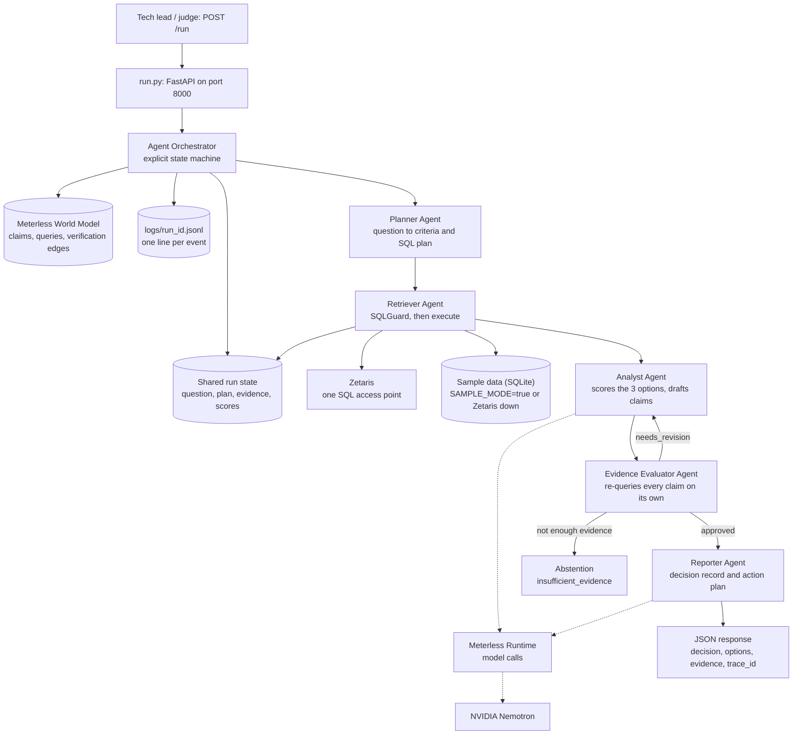
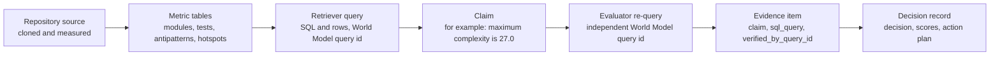

# Archus

> Track: The Agent That Can Explain Why
> Sponsor technology: Zetaris, Meterless, NVIDIA Nemotron, built in Cursor
> Run: `python run.py`, then `POST /run` on port 8000

Archus answers a question tech leads face on legacy code: should this module be
maintained, refactored, or migrated? It does not answer from a model's impression.
Five agents plan the checks, query code metrics through SQL, score the three
options from those metrics, and then try to disprove every number they used
before anything is written down. If the evidence is not there, Archus says so
(`insufficient_evidence`) instead of guessing.

## At a glance

| | |
| --- | --- |
| The problem | Maintain, refactor, or migrate is usually decided on opinion, then defended with numbers nobody can re-check |
| What Archus returns | A decision (maintain, refactor, migrate, or abstention), the scores of all three options, the claim behind each score, and the SQL that proves or kills it |
| Why it is not one prompt | The agent that writes the claims is not the agent that checks them. The EvidenceEvaluator runs its own queries and can send work back or block it |
| Shared state | Every claim, the query it came from, and the query that verified it are kept in a World Model that all agents read and write (`app/world_model.py`) |
| Check it yourself | Open any run in `logs/run_<id>.jsonl` and the matching record in `data/runs/<id>.json`; every claim names its table and its verification query |
| No keys needed | Sample mode runs the whole loop on local SQLite: `python run.py --sample --query "..." --repo django_app --module accounts` |

## 1. Problem

A tech lead who has to modernise a legacy module needs two things: a decision,
and a defence of that decision that a team can argue with. Today the decision is
often made in a meeting and the defence is written afterwards. Asking a language
model directly does not fix this: it will produce a confident recommendation and
cite complexity or coverage figures that may not exist anywhere.

Archus starts from the metrics instead. A repository is measured once (AST
complexity, coupling and cohesion, anti-patterns, test files, git hotspots,
dependencies). Those measurements live in tables. From then on, every number in
the answer has to come from a row, and an independent agent re-runs a query to
confirm it before the answer is final.

## 2. Agents

| Agent | Responsibility | Can block or retry? |
| --- | --- | --- |
| PlannerAgent | Turns the question into criteria and a list of SQL queries to run | Yes, replans when the Evaluator asks |
| RetrieverAgent | Validates each query with SQLGuard and executes it (Zetaris, or SQLite in sample mode) | Yes |
| AnalystAgent | Scores maintain, refactor and migrate from the retrieved metrics and drafts the claims | Yes, revises on Evaluator feedback |
| EvidenceEvaluatorAgent | Re-queries the data on its own to check each claim; approves, sends back, or abstains | Yes, it holds the veto |
| ReporterAgent | Writes the decision record: decision, options, verified evidence, action plan, summary | No |

## 3. What makes this an agent system

It is not a chain that summarises whatever the previous step produced.

- Analyst and Evaluator loop: the Evaluator returns `needs_revision` with
  feedback and the Analyst has to redo its work (`app/orchestration/graph.py`).
- The Evaluator queries the data itself. Approval is not a judgement call on the
  Analyst's text; it is a second, independent query whose result is compared
  with the claimed value.
- The Evaluator can block the whole run. Missing baseline metrics end in
  `insufficient_evidence`, with the missing items listed, not in a best guess.
- All five agents share one state object per run and one World Model across
  runs. A claim written by the Analyst is read back by the Evaluator and marked
  verified by the query that checked it, without erasing who wrote it first.
- Every step is traced as one JSON line, with agent, event, status and duration.

## 4. Architecture



Where each decision happens, in one run:

1. `analyze_and_ingest_repo` (`app/repo_analyzer.py`) clones a public GitHub
   repository, measures it with the imported ArchX collector (see
   [docs/preexistant.md](docs/preexistant.md)), and stores the metrics.
2. The Planner turns the question into criteria and planned queries.
3. The Retriever runs them through SQLGuard (`app/sqlguard.py`, read-only
   SELECT, table allow-list, forced LIMIT), then against Zetaris, or against
   local SQLite in sample mode.
4. The Analyst scores the three options from the metrics (`app/scoring.py`)
   and drafts one claim per number it relies on.
5. The Evaluator re-queries each claim independently. A mismatch means
   `needs_revision`; missing baseline data means abstention.
6. The Reporter writes the record. Only this prose step uses a model, through
   Meterless. The decision, the scores and the evidence are computed from data
   before the model is called, and they do not change if the model is replaced
   by the deterministic fallback text.

Lineage of one claim, which is what makes the answer checkable:



## 5. Tech stack

| Component | Technology |
| --- | --- |
| API | FastAPI and Uvicorn (`run.py`) |
| Orchestration | Explicit state machine (`app/orchestration/graph.py`) |
| Data access | Zetaris REST API, SQLite fallback in sample mode |
| SQL safety | SQLGuard, built on sqlglot (`app/sqlguard.py`) |
| Model runtime | Meterless Runtime (primary provider) |
| Models | NVIDIA Nemotron, via Meterless or an OpenAI-compatible endpoint |
| Shared agent state | World Model in SQLite (`app/world_model.py`) |
| Logging | JSONL in `logs/` and stdout |
| Web interface | Next.js and React in `frontend_archus/` |
| Container | Docker (`Dockerfile`) |
| Development | Cursor |

## 6. Sponsor technology

**Zetaris (data).** The metric tables (modules, tests, antipatterns, hotspots,
dependencies, repos) are meant to be queried through one SQL access point
instead of a connector per source. Archus calls the Zetaris REST SQL runner
(`POST /sql-editor/sqls/run`, `app/adapters/zetaris.py`) with the same SQL it
runs on SQLite in sample mode, so a claim means the same thing in both modes.
Two things are specific to this build. First, the Evaluator uses Zetaris
directly to check claims: approval requires its own query, not the Analyst's
word. Second, if Zetaris fails once during a run, a circuit breaker in
`app/orchestration/graph.py` sends the rest of that run to local SQLite and
says so in the log, rather than failing every query one by one. Registering
our tables in a fresh Zetaris instance is a manual step today; see
Limitations.

**Meterless (model runtime).** Model calls go through the Meterless Runtime
(`app/adapters/meterless_runtime.py`), which gives one configuration for local
and hosted runs: base URL and token are set once with `scripts/meterless.py`,
and the routing mode (`meterless/auto`, `meterless/deep`, and so on) can be
chosen per run. Archus also implements the Meterless World Model specification
as its shared agent memory (`app/world_model.py`): content-derived IDs,
provenance on every write, field-level merge with optimistic revision checks,
bitemporal verification edges, and an append-only event log that rebuilds the
state by replay. The official conformance checks for that specification are
ported to Python in `tests/test_world_model.py`. Read it back with
`GET /world/runs/{run_id}`, `GET /world/entities/{id}` and `GET /world/stats`.

**NVIDIA Nemotron (models).** The Reporter, and the follow-up question endpoint
(`POST /ask_architect`), write through Meterless to NVIDIA Nemotron; when the
runtime does not answer, Archus falls back to a direct OpenAI-compatible
Nemotron endpoint, and then to deterministic text. A real run records which of
the three actually wrote the prose: see the `llm_call` line in the trace, and
`output.model_provider` in the response. Models only write prose here. They do
not decide the verdict and they cannot invent a metric, because the numbers are
fixed and verified before the call.

**Cursor (development).** The project was built in Cursor. Agent chat was used
to scaffold the backend and the interface and to draft tests; every change was
read and run before it was kept.

## 7. Setup

```bash
cp .env.example .env     # fill in your keys; never commit .env
python -m venv .venv
source .venv/bin/activate        # on Windows: .venv\Scripts\activate
pip install -r requirements.txt
python run.py                    # serves on port 8000
```

Or with Docker:

```bash
docker build -t archus .
docker run --rm -p 8000:8000 --env-file .env archus
```

Live mode needs Zetaris running and the `ZETARIS_*` variables set in `.env`.
Meterless is connected separately, once:

```bash
python scripts/meterless.py detect   # find the local runtime
python scripts/meterless.py token    # paste the runtime token (hidden input)
python scripts/meterless.py status   # online, unauthorized, or offline
```

The web interface is optional and separate:

```bash
cd frontend_archus
npm install
NEXT_PUBLIC_API_URL=http://localhost:8000 npm run dev   # http://localhost:3000
```

## 8. Usage

```bash
curl -X POST http://localhost:8000/run \
  -H "Content-Type: application/json" \
  -d @input_examples/example_1_refactor.json
```

Request (`input_examples/example_1_refactor.json`):

```json
{
  "input": {
    "query": "Should we refactor or maintain the accounts module in django_app?",
    "repo": "django_app",
    "module_path": "accounts"
  },
  "options": {
    "sample_mode": true
  }
}
```

Response (abridged from `output_examples/output_1_refactor.json`; the full
record also carries `claim_id`, `cited_query_ids` and `verified_by_query_id`
per evidence item):

```json
{
  "run_id": "cae2078a",
  "status": "success",
  "output": {
    "decision": "refactor",
    "confidence": 0.8,
    "options_compared": [
      { "option": "maintain", "score": 52.0,
        "rationale": "Current max complexity is 14.0 with 7 bug fixes recorded." },
      { "option": "refactor", "score": 67.4,
        "rationale": "Test coverage is 68.5% with coupling score of 3.8." },
      { "option": "migrate", "score": 17.7,
        "rationale": "God classes detected: 0, coupling score: 3.8." }
    ],
    "evidence": [
      {
        "claim": "Maximum cyclomatic complexity is 14.0",
        "metric": "complexity_max",
        "source_table": "modules",
        "sql_query": "SELECT complexity_max FROM modules WHERE repo_id = 'django_app' AND module_path = 'accounts' LIMIT 1",
        "value": 14.0,
        "verified": true
      },
      {
        "claim": "Test coverage estimate is 68.5%",
        "metric": "coverage_estimate",
        "source_table": "tests",
        "sql_query": "SELECT coverage_estimate FROM tests WHERE repo_id = 'django_app' AND module_path = 'accounts' LIMIT 1",
        "value": 68.5,
        "verified": true
      }
    ],
    "action_plan": [
      "Decompose long methods into pure helper functions covered by existing tests.",
      "Decouple cross-module references using dependency inversion."
    ]
  },
  "trace_id": "trace-cbfe60db-3ac3-47a4-b3b7-4540ba92c4f8"
}
```

A real repository needs no sample data: pass its GitHub URL as `repo`
(for example `https://github.com/pallets/flask`) and leave `sample_mode` off.
The run clones it, measures it, and answers about that code.

Other endpoints: `GET /health`, `GET /runs/{run_id}`,
`POST /ask_architect`, `GET /providers`, `GET /providers/meterless/status`,
`GET /world/runs/{run_id}`, `GET /world/entities/{id}`, `GET /world/stats`.

A run a judge can inspect end to end: `logs/run_2db6050a.jsonl` (Flask,
`sample_mode: false`), with its record in `data/runs/2db6050a.json`. Three
lines tell most of the story: the Retriever's `sql_executed` lines give each
query and its duration, the Evaluator's `claim_verified` lines give expected
and actual values side by side, and the Reporter's `llm_call` line records
that Meterless timed out and a direct Nemotron call wrote the summary.

## 9. Sample mode

`SAMPLE_MODE=true`, or `"sample_mode": true` in a request, runs the full agent
loop on the metrics in `data/sample_metrics.db`, with no live credentials.
The same agents plan, guard, query, score and verify; nothing is replayed from
a stored answer. Three prepared cases are in `input_examples/`, with their
expected shape in `output_examples/`: a refactor, a migration, and an
abstention where the data is not sufficient.

## 10. Failure handling

| Failure | Behaviour |
| --- | --- |
| Zetaris unreachable or returns an error | Logged once, then the rest of the run uses local SQLite (circuit breaker) |
| A query fails in sample data | The claim that needed it is marked unverified and listed as missing |
| A claim does not match the data | Evaluator returns `needs_revision` and the Analyst revises (at most two cycles) |
| Baseline metrics are missing | The run ends as `insufficient_evidence` and names what is missing |
| SQL is not a single read-only SELECT, or touches a table outside the allow-list | SQLGuard rejects it before anything executes |
| Meterless times out or is offline | Falls back to the direct Nemotron endpoint, then to deterministic text; the decision is unchanged |
| Malformed request | FastAPI returns a validation error naming the field |

## 11. What was imported

Archus is a new build, but it is not all new. The short version; the full
declaration, with paths and dates, is in
[docs/preexistant.md](docs/preexistant.md).

- The AST metrics collector from the author's earlier ArchX project
  (`architect_insight/`, complexity, patterns, coupling, git hotspots,
  tests). Archus wraps it as an ingestion source and did not rewrite it. It
  is used locally and is not committed to this repository.
- The ArchX demo projects used as analysis targets during development.
- The Meterless World Model specification, reimplemented in Python in
  `app/world_model.py`, with its conformance checks ported to
  `tests/test_world_model.py`.
- `smoke_test.py`, from the hackathon Participant Setup Guide, used to check
  the Zetaris setup.
- Open-source libraries: FastAPI, Uvicorn, Pydantic, requests, the OpenAI
  Python client, python-dotenv, sqlglot and pytest on the backend; Next.js,
  React, Tailwind CSS, Radix UI primitives, lucide-react and framer-motion
  in `frontend_archus/`. None of them was modified.
- Sponsor services used as designed, not vendored: the Zetaris REST API, the
  Meterless Runtime, and NVIDIA Nemotron endpoints.

Everything else, the five agents, the orchestration, SQLGuard, the Zetaris
and Meterless adapters, the scoring, the API, and the web interface, was
written for this build.

## 12. Data and licensing

Sample metrics in `data/sample_metrics.db` are synthetic or derived from the
public repositories named in them, and are labelled by repository. Analyses of
public GitHub repositories use those projects' own code under their own
licences; Archus stores measurements, not source. Git author names and emails
from hotspot analysis are filtered out before anything is stored or shown.
No credentials are committed: `.env` is gitignored and only `.env.example`
ships. There is no project licence file yet; the imported components keep the
licences noted in [docs/preexistant.md](docs/preexistant.md).

## 13. Limitations

- Zetaris registration is manual. The tables have to exist in the Zetaris
  catalogue before a live run can read them; until then the circuit breaker
  serves the run from local SQLite and the trace says so. The first query of
  a live run is the one that finds out.
- Coverage is an estimate derived from test files, not a measured coverage
  run. The field is named `coverage_estimate` everywhere for that reason.
- The measured metrics are strongest for Python repositories, because the
  imported collector is a Python AST analyser. Other languages are counted
  (files, lines) but their complexity numbers are weaker.
- Metrics describe structure, not intent. A complex module may be complex
  because the problem is. Archus reports the numbers and their provenance;
  the decision to act stays with the team.
- Questions and reports are in English.
- The web interface is a demonstration front end for the API, not a separate
  product.

## Tests

```bash
python -m unittest discover -s tests -v   # World Model, Meterless runtime, provider selection
python scripts/judge_check.py             # sample-mode pipeline checks, end to end
```
